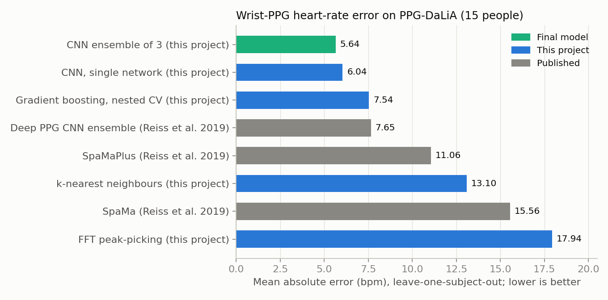
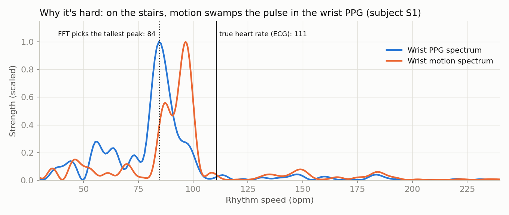
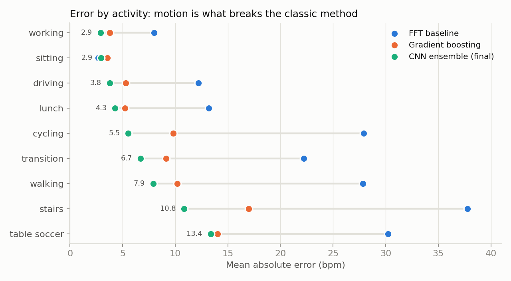
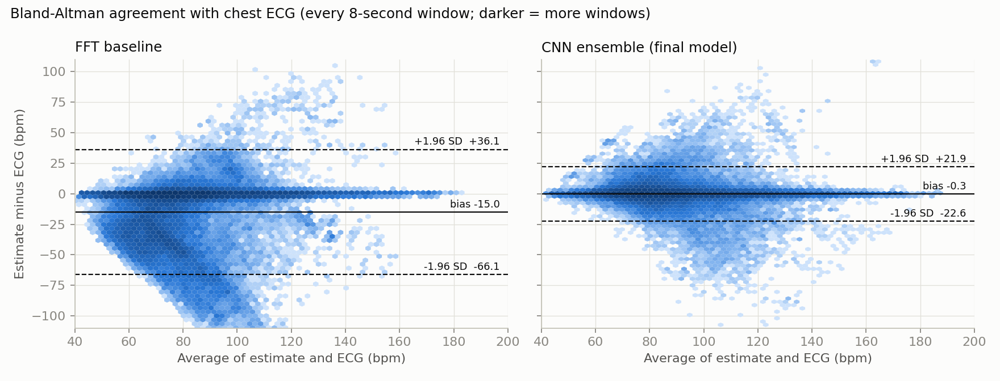
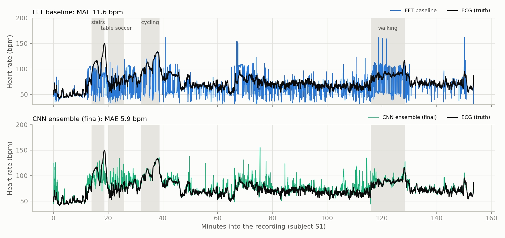

# Wrist PPG Heart-Rate Estimation During Daily Life

[](https://github.com/elijahgkschechter/ppg-hr-estimation/actions/workflows/tests.yml)

Estimating heart rate from a **wrist PPG sensor + accelerometer** (the sensors in an Apple Watch,
WHOOP, or Oura-style device) while people go about real daily activities, and validating it against
**chest ECG** the way a wearable-validation team would.

**Result:** a 3-network CNN ensemble reaches **5.64 bpm mean absolute error** under
**leave-one-subject-out** evaluation (every prediction is for a person the model never trained on):
**26% lower error than the published Deep PPG CNN ensemble (7.65 bpm)** and **69% lower than
standard FFT signal processing (17.9 bpm)**. A single network scores **6.04 ± 0.02 bpm** across three
independent training runs.



---

## The problem

PPG shines light into the skin and measures the tiny change in reflected light with each pulse. When
the wrist moves, the watch shifts on the skin and the motion signal is often **stronger than the
pulse**. A classic method (pick the strongest rhythm in the spectrum) then reports the motion rhythm
instead of the heartbeat:



**Dataset:** [PPG-DaLiA](https://doi.org/10.24432/C53890) (Reiss et al., 2019): 15 people, ~2.5 h
each, 8 activities (sitting, stairs, table soccer, cycling, driving, lunch, walking, desk work).
Wrist PPG at 64 Hz, wrist 3-axis accelerometer at 32 Hz, ECG-derived heart rate for every 8-second
window (2-second step), **64,697 windows**.

## Results

All numbers are leave-one-subject-out; MAE is the average of the 15 per-person MAEs (the convention
used by the dataset authors).

| Method | MAE (bpm) | Within 5 bpm | Notes |
|---|---|---|---|
| FFT peak-picking | 17.9 | 53.6% | band-pass + strongest spectral peak, no ML |
| SpaMa (published) | 15.56 | | Reiss et al. 2019 |
| k-nearest neighbours | 13.1 | | spectra of PPG + motion |
| SpaMaPlus (published) | 11.06 | | Reiss et al. 2019 |
| Deep PPG CNN ensemble (published) | 7.65 | | Reiss et al. 2019 |
| Gradient boosting | 7.54 | 61.5% | engineered peak + 30 s history features, **nested** CV |
| CNN, single network | 6.04 ± 0.02 | 73.5% | mean ± SD over 3 training runs |
| **CNN ensemble (3 networks)** | **5.64** | **73.6%** | average of the 3 runs |



## Validation, the way a sensor team would report it

Agreement with ECG over all 64,697 windows:

| | FFT baseline | Final model |
|---|---|---|
| Bias (mean of estimate − ECG) | −15.0 bpm | **−0.3 bpm** |
| 95% limits of agreement | −66.1 to +36.1 bpm | **−22.6 to +21.9 bpm** |
| MAPE | 18.0% | **6.3%** |
| Pearson r | 0.40 | **0.87** |
| Within max(5 bpm, 10%) | 57.6% | **82.5%** |
| Windows off by > 20 bpm | 32.7% | **7.1%** |



**Findings**

- **The classic method is biased, not just noisy.** 94% of its large errors read *too low*: motion
  and drift energy is mostly slow, so the wrong peak usually sits below an exercising heart rate.
  The final model's bias is essentially zero.
- **The model learned to ignore motion.** Big errors caused by locking onto a motion rhythm fell from
  13.7% of windows to 1.8%; half/double-rate (harmonic) errors fell from 8.3% to 0.3%.
- **Improvements hold person by person** (Wilcoxon signed-rank on per-person MAE): final vs. FFT,
  better for 15/15 people (p = 0.0001); final vs. gradient boosting, 13/15 (p = 0.003).
- **Remaining weak spots:** table soccer (13.4 bpm) and stairs (10.8 bpm), i.e. jerky, irregular arm
  motion; and subject S8, whose error is elevated even while sitting (a signal-quality hypothesis,
  not a conclusion).



## Approach

1. **Data pipeline:** raw 1.5 GB/person pickles → compact wrist-only files with integrity checks
   (signal lengths, label counts) → 8-second windows aligned to the ECG labels.
2. **Baseline:** Butterworth band-pass (0.5-4 Hz) + zero-padded FFT, strongest peak = heart rate.
3. **Features:** PPG and 3-axis motion spectra (30-240 bpm); top PPG/motion peak locations and
   heights; motion intensity; the previous 30 s of peak features; running averages of the PPG spectrum.
4. **Gradient boosting** (absolute-error loss) + snapping each estimate to the nearest PPG peak.
5. **CNN** (PyTorch, Apple-silicon GPU): 5 dilated 1-D convolution layers read the PPG + motion
   spectra of the current and previous 7 windows and output a probability for every heart rate
   (1.875-bpm bins); trained with soft Gaussian labels. ~36k parameters, ~9 s per training fold.

## How the evaluation stays honest

- **Leave-one-subject-out everywhere.** Windows overlap by 6 of 8 seconds, so a random train/test split
  leaks near-duplicates: it made a KNN look like 8.1 bpm when its honest error is 13.1 bpm.
- **Nested cross-validation** for every design choice in the gradient-boosting model (feature set,
  number of trees, snapping): choices are made using only the training people.
- **Found and fixed a hidden leak:** scikit-learn's automatic early stopping validates on a *random*
  10% of windows (the same overlap leak); it is disabled, and a test guards against it coming back.
- **Rules fixed before seeing results:** CNN settings and the ensemble rule were set in advance; a
  pre-declared CNN + booster blend that scored worse (6.53 bpm) is reported, not hidden.
- **Stability:** three independent CNN training runs agree within ±0.02 bpm.
- **30 automated tests** (`pytest`, run on every push), including "spy model" tests that fail if a
  test person is ever used for training.

## Limitations

- **Skin tone cannot be assessed with this data.** 11 of 15 participants are Fitzpatrick type 3 and
  none are type 5-6. No relationship between skin type and error was found (Spearman ρ = 0.24,
  p = 0.38), but absence of evidence here is not evidence of equal performance.
- **15 people, one wrist device (Empatica E4), one lab's protocol.** Results may not transfer to other
  devices, populations, or intense exercise.
- **Context:** the models use up to ~30 s of *past* signal (feasible in real time); Deep PPG used a
  single 8-second window, so the comparison is not perfectly like-for-like.
- 95% limits of agreement are still about ±22 bpm: most windows are close, but a minority of
  high-motion windows remain far off.

## Repository layout

```
src/ppghr/        reusable package
  data.py         load raw pickles, integrity checks, compact .npz files
  windows.py      8-second windows aligned to the heart-rate labels
  baseline.py     band-pass filter, spectra, FFT baseline
  features.py     spectral, peak and history features
  models.py       gradient boosting + peak snapping
  deep.py         spectral CNN (PyTorch)
  evaluate.py     leave-one-subject-out and nested evaluation
  validation.py   Bland-Altman, agreement statistics, failure-mode classification
scripts/          make_dataset, run_step8, run_step9, run_step9_seeds, make_figures, reproduce.sh
notebooks/        01-07: exploration → baseline → evaluation → boosting → CNN → error analysis
tests/            30 pytest tests (synthetic signals with known answers + real-data checks)
results/          JSON summaries of every experiment
figures/          figures in this README
```

## Reproduce

```bash
python3.12 -m venv .venv && source .venv/bin/activate
pip install -r requirements.txt && pip install -e .
# download PPG-DaLiA and place it next to this folder as ../ppg+dalia/
bash scripts/reproduce.sh        # tests, data prep, all experiments, error analysis (~1.5-2 h)
python scripts/make_figures.py   # README figures
```

## Data and references

- Reiss, A., Indlekofer, I., & Schmidt, P. (2019). *PPG-DaLiA* [Dataset]. UCI Machine Learning
  Repository. https://doi.org/10.24432/C53890 (CC BY 4.0). The data is not included in this repository.
- Reiss, A., Indlekofer, I., Schmidt, P., & Van Laerhoven, K. (2019). Deep PPG: Large-scale heart rate
  estimation with convolutional neural networks. *Sensors*, 19(14), 3079.

Code: MIT License. Author: Elijah Schechter.
